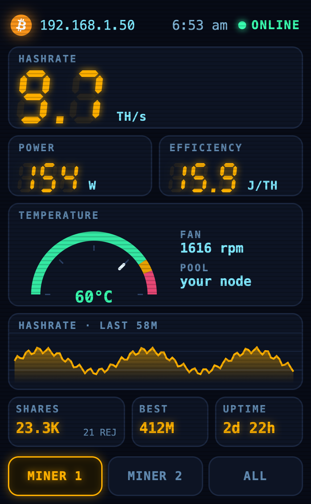
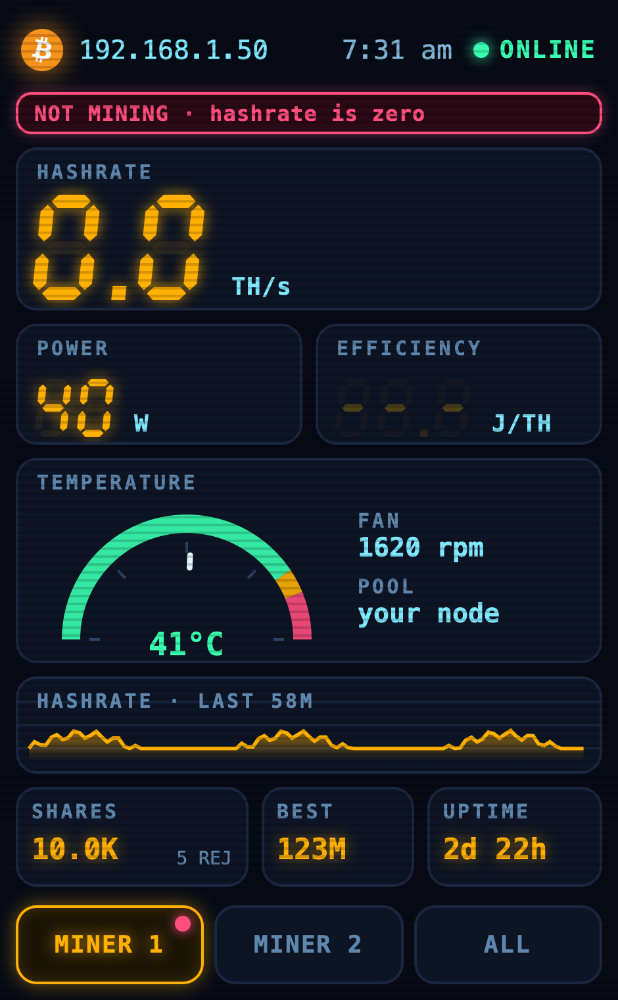

# Solo Miner Desktop Widget

A small, always-on-top macOS desktop widget for home Bitcoin miners that run AxeOS (the firmware family used by Bitaxe and NerdAxe-type miners).

It reads each miner's local `http://<ip>/api/system/info` and shows:

- seven-segment hashrate, power and efficiency (J/TH)
- a temperature gauge and fan speed
- a one-hour hashrate chart
- accepted/rejected shares, best difficulty and uptime
- a toggle between miners, plus a combined view
- alerts when a miner stops mining, stops finding shares, falls back to its backup pool, goes offline or runs hot: a banner on the widget, a dot on the miner's button, and a macOS notification

| One miner | All miners |
| --- | --- |
|  |  |

The screenshots show sample data, not anyone's live miner address.



A miner that is not mining, shown with sample data.

## How it works

- `widget/miner_widget_server.py` is a tiny Python server (standard library only) on `localhost:8757`. It polls your miners about every 15 seconds, watches for the alert conditions below, and serves the page and a JSON feed.
- `widget/miner_widget.html` is the widget page. It loads nothing from the internet: no external scripts, fonts, images or requests. The only network traffic is the server asking your own miners for their status.
- `widget/miner_widget_window.swift` is a small Swift window (WebKit) that shows the page, floating above other windows.
- `widget/miner_alerts_summary.py` prints one plain-English line about the last 24 hours of alerts.
- Two LaunchAgents start the server and the window at login.

## Tested on

Tested only on a NerdOCTaxe. Other AxeOS miners should work because they expose the same `/api/system/info`, but they are untested.

## Requirements

- macOS with the Xcode Command Line Tools (`xcode-select --install`) for `swiftc`
- `python3` (ships with the Command Line Tools; the system `python3` is used)
- A miner on your local network running AxeOS

## Install

```sh
git clone <this repository>
cd solo-miner-desktop-widget
./install.sh
```

`install.sh` checks for macOS, `swiftc` and `python3`, compiles the Swift window, creates `widget/miners.json` from the example if it does not exist, writes two LaunchAgents into `~/Library/LaunchAgents` (`com.solominer.widget-server` and `com.solominer.widget-window`) using your home folder and this folder's path, and loads them. Do not move the folder afterwards without running `./install.sh` again.

## Configure your miners

Edit `widget/miners.json`:

```json
[
  {"name": "Miner 1", "host": "192.168.1.50"},
  {"name": "Miner 2", "host": ""}
]
```

`host` is the miner's IP address on your network (you can also include a port, like `192.168.1.50:8080`). An empty host shows "not plugged in yet". The file is read on every refresh, so changes show up within about 30 seconds.

### Showing "your node"

If your miner points at your own Bitcoin node, you can have the widget say so. Use the object form of the file and list the stratum host(s) of your node:

```json
{
  "miners": [
    {"name": "Miner 1", "host": "192.168.1.50"}
  ],
  "my_node_hosts": ["192.168.1.10"]
}
```

When a miner's reported stratum host is in `my_node_hosts`, the pool field shows "your node". Otherwise it shows the pool host name the miner reports, and "backup pool" when the miner is on its fallback pool. `my_node_hosts` is optional.

### Alert settings

Alert settings live in the object form of the same file, next to `miners`. Both are optional:

```json
{
  "miners": [
    {"name": "Miner 1", "host": "192.168.1.50"}
  ],
  "notify": true,
  "alerts": {
    "no_shares_minutes": 10,
    "offline_minutes": 2,
    "not_mining_ths": 0.1,
    "reminder_minutes": 60
  }
}
```

### Environment variables

- `MINER_CONFIG`: path to the config file (default `widget/miners.json`)
- `MINER_PORT`: server port (default `8757`). `install.sh` does not read it. If you change it, edit both plists in `~/Library/LaunchAgents`: add `MINER_PORT` under `EnvironmentVariables` in `com.solominer.widget-server.plist`, and change the URL in `com.solominer.widget-window.plist`. Then reload both agents.

## Alerts

The server checks every miner on each poll and raises an alert when:

| Alert | Colour | Trips when |
| --- | --- | --- |
| NOT MINING | red | the miner answers but reports under 0.1 TH/s on 2 polls in a row (`not_mining_ths`) |
| NO SHARES | red | the miner answers but its accepted-share count has not gone up for 10 minutes (`no_shares_minutes`) |
| BACKUP POOL | amber | the miner reports it is on its fallback pool |
| OFFLINE | red | the miner has not answered for 2 minutes (`offline_minutes`) |
| HOT | red | the miner reports 70 °C or more |

Notes on how they behave:

- NO SHARES needs a baseline: the server must have watched the miner without a break for the full 10 minutes before it can raise this. A share count that drops (the miner rebooted) counts as movement, not a stall. A gap of more than 2 minutes between answers starts the watch again.
- OFFLINE shows in the panel straight away as "not answering"; the alert and notification wait the 2 minutes so a short blip stays quiet.
- On the widget, the selected miner shows a banner under the status bar (red, or amber for the backup pool). Each miner's button shows a small red or amber dot while it has an alert, so a problem on another miner is visible, and the combined view lists each miner's alert.
- Notifications: one macOS notification when a miner goes into an alert (title "Miner alert"), one when all of that miner's alerts clear, and one reminder every 60 minutes (`reminder_minutes`) while an alert stays on. They are posted with `/usr/bin/osascript`. If that fails, the failure is written to `widget/server.log` and the widget carries on. Alerts are tracked only while the server runs, so a restart can post a fresh notification for a condition that was already active.
- Turn notifications off with `"notify": false` in `widget/miners.json`. Banners, dots and the log stay on.
- Every raise, reminder and clear is appended to `widget/alerts.log` (next to `miners.json`, never committed), one line each: local time, miner name, alert code, what happened, text.
- `python3 widget/miner_alerts_summary.py` prints one line about the last 24 hours, for example `Miner alerts in the last 24 hours: Miner 1 not mining 2:14am to 2:31am; Miner 1 on backup pool since 3:05am.` or `... none.`

## macOS Local Network permission

Background programs cannot reach devices on your home network until you allow it once. If the widget shows "not answering" even though the miner's own web page loads in your browser, open System Settings > Privacy & Security > Local Network and allow the Python program (the widget server). Then restart the server:

```sh
launchctl kickstart -k gui/$(id -u)/com.solominer.widget-server
```

## Using it

- Move it: click and drag anywhere on the widget (not on the buttons). It remembers its position.
- Switch: the buttons at the bottom pick a miner or the combined view. The choice is remembered.

## Uninstall

```sh
./uninstall.sh
```

This unloads the two LaunchAgents and removes only the two plist files that `install.sh` installed (`com.solominer.widget-server.plist` and `com.solominer.widget-window.plist`). Your `widget/miners.json` and this folder are left alone.

## Security

The local server only answers requests addressed to localhost. Alerts add no network traffic: the only requests are still to your own miners.

## Tests

```sh
python3 -m unittest discover -s tests
```

## Troubleshooting

- Widget does not appear: check that `swiftc` is installed and re-run `./install.sh`.
- "Not answering": check the miner's IP address, that `http://<ip>/api/system/info` opens in a browser, and the Local Network permission above.
- "Miner list could not be read": `widget/miners.json` is not valid JSON.
- Server errors are written to `widget/server.log`.

## License

MIT, see [LICENSE](LICENSE).

Built by Stelar Digital · stelardigital.com
